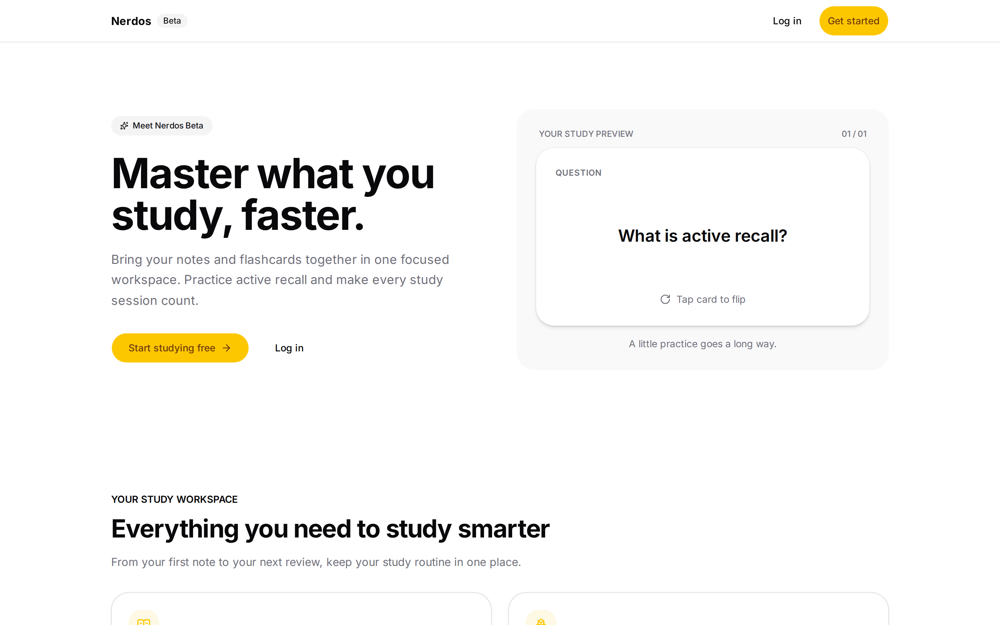
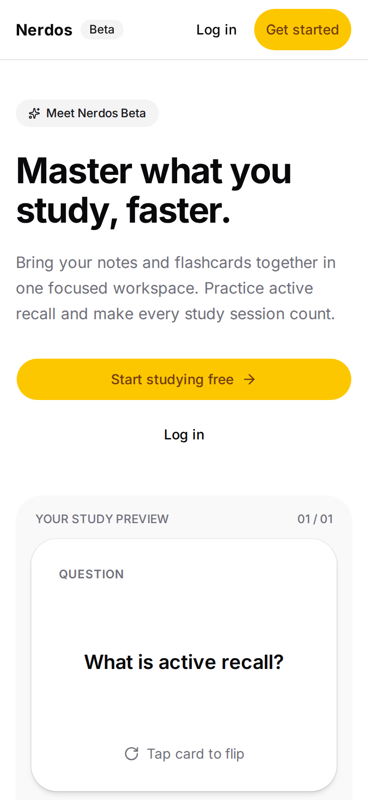
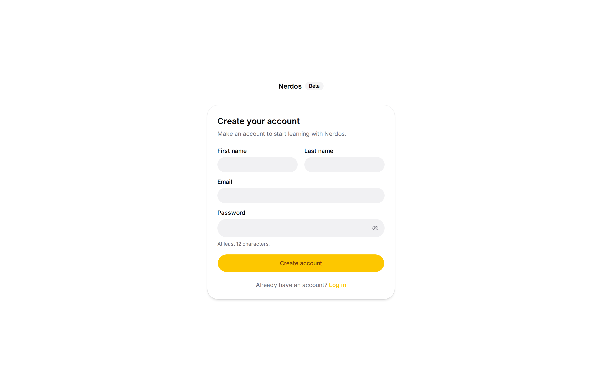
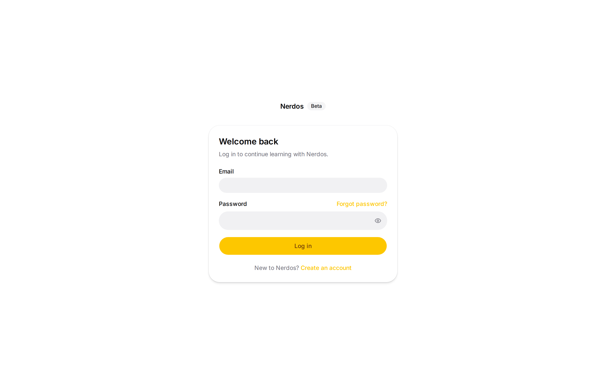
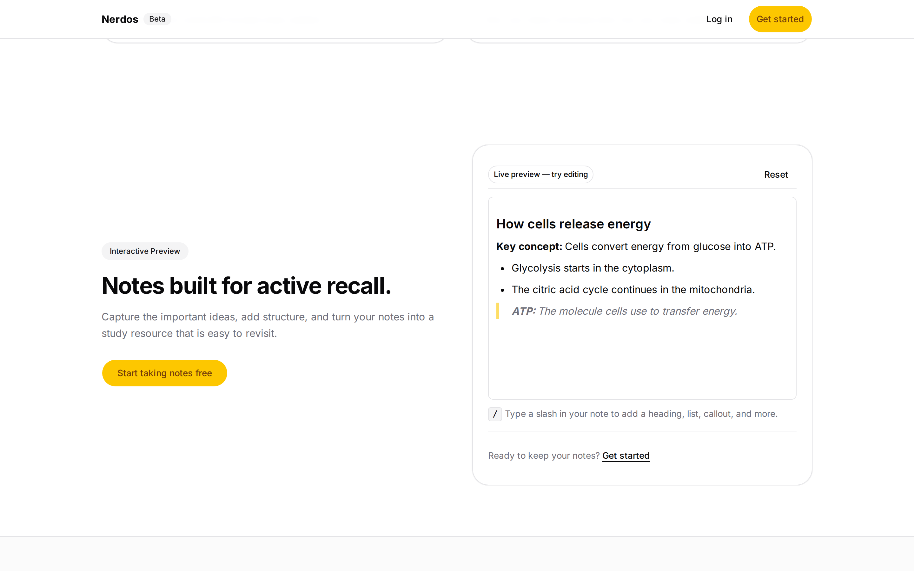
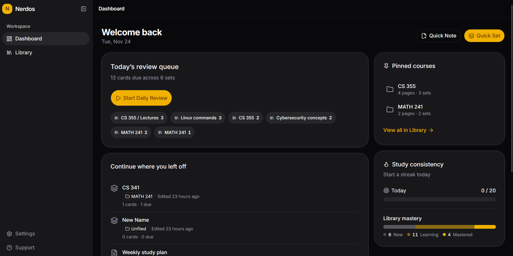
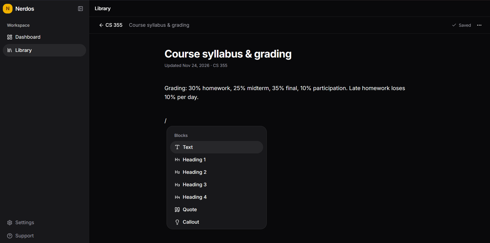
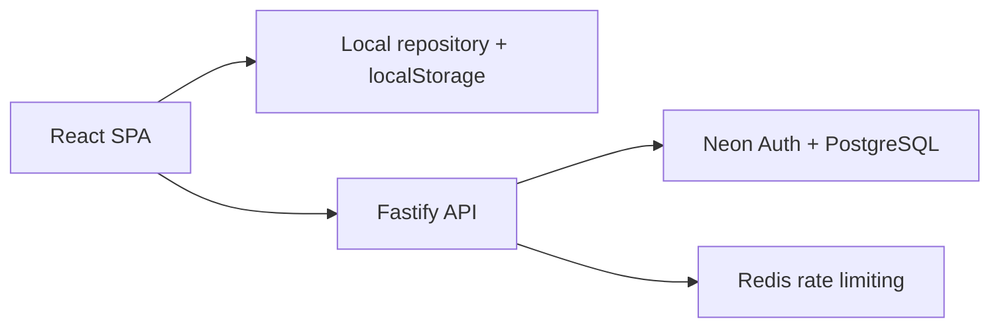

# Nerdos

A unified, mobile-first study workspace that combines rich-text note-taking with spaced-repetition flashcards, built to evolve into an AI-assisted learning platform.

> **Project status:** Foundational architecture and MVP UI are in active development (`v0.1.0`).

## Screenshots

| Landing page — desktop | Landing page — mobile |
| :---: | :---: |
|  |  |

| Create an account | Log in |
| :---: | :---: |
|  |  |



### Study workspace

| Dashboard | Unified Library |
| :---: | :---: |
|  |  |
| **Plate Note Canvas** | **Notecard Set Manager** |
|  |  |

## Why Nerdos

Students frequently split their study workflow across disconnected note editors and flashcard apps. That creates friction between capturing concepts and actively recalling them.

**Nerdos** brings notes, course folders, active recall, and review scheduling into one workspace so study material can move directly into review sessions. The planned AI features will integrate with a student's own learning material to make studying more time-efficient and effective.

## Current MVP

- **Dashboard:** due-review queue, recent work, pinned courses, daily streak, and mastery snapshot
- **Library:** nested course folders, notes, and notecard sets in one workspace
- **Plate note canvas:** rich text, slash commands, links, lists, code blocks, tables, and autosave
- **Notecard manager:** quick-add, search, edit, move, delete, and reset progress
- **Active recall:** standard flip and typed-answer modes with FSRS interval previews
- **Mobile-first UI:** responsive navigation and layouts designed from `375px` upward

The library MVP currently uses an async repository backed by `localStorage`. Authentication uses the API; verify-email and password recovery pages are still placeholders.

## Planned AI Learning Features

With the core application foundation currently being established, upcoming milestones will introduce embedded AI workflows designed to reinforce active learning rather than passive reading:

- **Automated flashcard generation:** convert structured notes and highlighted sections into spaced-repetition card decks.
- **Semantic note linking and concept search:** retrieve related concepts across personal notes while studying.
- **Socratic study companion:** provide context-aware prompts and explanation checks grounded in the student's own library.
- **Smart review prioritization:** combine learning context with spaced-repetition intervals to prioritize reviews.

AI assistance is a roadmap direction; it is not presented as a replacement for recall, practice, or a learner's own reasoning.

## Repository

```text
nerdos/
├── nerdos-web/   # React SPA: Vite, TypeScript, Tailwind CSS, shadcn/ui, Plate
├── nerdos-api/   # Fastify TypeScript API with Neon Auth and PostgreSQL
├── docs/         # Product screenshots and supporting documentation
└── .github/      # Repository guidance and dependency automation
```

## Architecture At A Glance



### Web

The React frontend uses Tailwind CSS, shadcn/ui, and Plate. A shared `ky` client and [endpoint registry](nerdos-web/src/config/api-endpoints.ts) handle API requests. Features are organized independently; see the [web technical README](nerdos-web/README.md), [Library](nerdos-web/src/features/library), and [Dashboard](nerdos-web/src/features/dashboard).

### API

The Fastify API integrates Neon Auth and PostgreSQL, with Redis for rate limiting. See the [API technical README](nerdos-api/README.md), [server entrypoint](nerdos-api/src/server.ts), and [modules](nerdos-api/src/modules).

## Run Locally

```bash
git clone <repository-url>
cd nerdos
```

Start the web application:

```bash
cd nerdos-web
pnpm install --frozen-lockfile
cp .env.example .env
pnpm dev
```

Set `VITE_API_BASE_URL` in `nerdos-web/.env` to the API origin; local development defaults to `http://localhost:3000` when it is unset. Production builds require this public URL to be configured.

Start the API foundation:

```bash
cd nerdos-api
pnpm install --frozen-lockfile
cp .env.example .env
```

Configure `.env` as described in the API guide, then run `make dev-backend` from the repository root. The root Makefile also provides `make dev-frontend` and `make dev` to run the frontend and backend together. For local Redis, run `make services-up` first; see the API guide for the connection settings.

Use `make build` to build both apps, `make build frontend` or `make build backend` to build one, and `make help` to list the remaining commands. The backend development command loads `nerdos-api/.env` if present and automatically loads the generated local Redis credentials and certificate when the local Compose Redis URL is configured. `make dev` stops both servers when interrupted; it does not start or stop the Compose services.

For prerequisites, environment-variable conventions, architecture rules, and troubleshooting, use the project-specific guides:

- [Web setup and technical guide](nerdos-web/README.md)
- [API setup and technical guide](nerdos-api/README.md)

## Engineering Direction

- Repository interfaces separate UI from persistence.
- Domain features remain isolated behind public service boundaries.
- The API is a modular monolith, not a collection of independent app instances.
- Secrets remain server-side; frontend configuration must be public-only.
- Mobile accessibility and predictable empty/error states are first-class requirements.

## Documentation

- [Repository instructions](.github/copilot-instructions.md)
- [Dependabot configuration](.github/dependabot.yml)
- [Product screenshots](docs/images)

## License

See [LICENSE](LICENSE).
