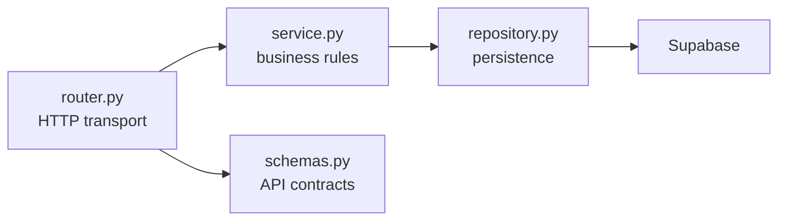

# Nerdos API

FastAPI backend for Nerdos, managed with `uv` and designed as a strictly isolated modular monolith backed by Supabase.

This guide covers backend setup, architecture, workflow, and troubleshooting. For the product overview, see the [root README](../README.md). For frontend architecture and local UI development, see the [web README](../nerdos-web/README.md).

## Status

The backend is at its foundation stage. [`src/main.py`](src/main.py) currently provides the single FastAPI app, lifespan hooks, CORS middleware, and `/health`. The [`src/shared`](src/shared) and [`src/modules`](src/modules) directories are reserved for the next infrastructure and domain modules.

## Tech Stack

- Python 3.12+
- FastAPI with Pydantic
- `uv` for Python, dependency, lockfile, and command management
- `pydantic-settings` for centralized configuration
- Supabase for Auth, Postgres, Storage, and RLS-backed data access
- Loguru for structured application logging
- Ruff and pytest for verification

## Prerequisites

- [`uv`](https://docs.astral.sh/uv/)
- Python 3.12 or newer

Check the tools available to the project:

```bash
uv --version
uv python list
```

## Install And Run

```bash
cd nerdos-api
uv sync
uv run fastapi dev src/main.py
```

The development server prints its local URL. Verify liveness at:

```text
GET /health
```

Expected response:

```json
{"status":"ok"}
```

Interactive API documentation is served by FastAPI at `/docs` during local development.

## Dependency Workflow

Use `uv` exclusively in this project. Do not use `pip`, `poetry`, or `python -m` as substitutes.

```bash
uv add package-name          # Runtime dependency
uv add --dev package-name    # Development dependency
uv remove package-name       # Remove a dependency
uv sync                      # Reconcile .venv with pyproject.toml and uv.lock
uv lock                      # Regenerate the lockfile
```

Commit [`pyproject.toml`](pyproject.toml) and [`uv.lock`](uv.lock) together. Do not commit `.venv`.

## Verification

Run the required backend checks from `nerdos-api/`:

```bash
uv run ruff check .
uv run pytest
```

Additional focused checks:

```bash
uv run ruff format --check .
uv run fastapi dev src/main.py
```

## Application Entry Point

[`src/main.py`](src/main.py) is the composition root. It should remain focused on application wiring:

- create the one FastAPI instance
- own lifespan startup and shutdown hooks
- add cross-cutting middleware
- register module routers
- expose process-level health information

Do not create additional `FastAPI()` instances inside feature modules. Each module should expose an `APIRouter` and be registered once from the composition root.

## Target Architecture

```text
src/
├── shared/
│   ├── config.py          # Pydantic settings and public configuration
│   ├── logging.py         # Loguru setup
│   ├── security.py        # Authentication and authorization dependencies
│   └── supabase.py        # Shared Supabase client construction
├── modules/
│   └── <domain>/
│       ├── router.py      # HTTP transport and route contracts
│       ├── schemas.py     # Pydantic request/response models
│       ├── service.py     # Domain workflows and public cross-module API
│       └── repository.py  # Supabase and persistence access
└── main.py                # Single application composition root
```

Each feature boundary follows the same flow:



## Module Boundaries

- Keep `router.py` thin. It validates HTTP input, resolves dependencies, and maps outcomes to responses.
- Put orchestration and business rules in `service.py`.
- Keep Supabase queries isolated in `repository.py`.
- Never import another module's `repository.py`.
- Never query another module's tables directly from a different module.
- Cross-module workflows call public functions exposed from the other module's `service.py`.
- Register each module router in [`src/main.py`](src/main.py).
- Prefer typed `Annotated[..., Depends(...)]` dependencies and annotated return types.

These rules allow the API to remain a deployable modular monolith while preserving future extraction options.

## Shared Infrastructure

The intended shared layer is technical infrastructure only. It may own configuration, logging, security, events, and Supabase client setup. It should not become a miscellaneous domain-service folder.

Configuration must use a centralized `pydantic-settings` model with `SecretStr` for secrets. Application code must not call `os.getenv()` directly.

## Supabase Boundaries

Use the backend skills before implementing Supabase work:

- [`.agents/skills/fastapi`](.agents/skills/fastapi) for FastAPI conventions
- [`.agents/skills/supabase`](.agents/skills/supabase) for Auth, Storage, RLS, and client integration
- [`.agents/skills/supabase-postgres-best-practices`](.agents/skills/supabase-postgres-best-practices) for schema, migration, index, and query guidance

Supabase access stays server-side. Browser code should receive only public configuration; service-role keys must never be exposed to `nerdos-web`.

## Environment Variables

Create a local `.env` from the committed `.env.example` template, but never commit or print the populated `.env` file.

All runtime settings should be declared in the centralized settings model. Add placeholder keys to `.env.example` only. The repository [`.gitignore`](../.gitignore) ignores `.env` while allowing `.env.example` templates.

## Testing Strategy

- Unit tests should exercise service rules with mocked repositories.
- Repository integration tests should isolate Supabase or database fixtures.
- Router tests should use FastAPI's test client and verify status codes and response schemas.
- Tests should not depend on production credentials or a live user account.

Suggested layout:

```text
tests/
├── modules/
│   └── <domain>/
│       ├── test_router.py
│       ├── test_service.py
│       └── test_repository.py
└── conftest.py
```

## Troubleshooting

### `fastapi` cannot be resolved in the editor

Make sure VS Code is using the API interpreter at `nerdos-api/.venv/bin/python`, then reload the Python language server.

The runtime can be checked independently with:

```bash
uv run python -c "import fastapi; print(fastapi.__version__)"
```

### `uv.lock` and the environment disagree

Reconcile the project environment:

```bash
uv sync
```

### The development server cannot find the app

Run the command from `nerdos-api/` and use the current entrypoint explicitly:

```bash
uv run fastapi dev src/main.py
```

When the composition root moves or an app entrypoint is configured in `pyproject.toml`, update this command and the documentation together.

### The API starts, but Supabase operations fail

Do not print secret values. Check that the expected placeholder names exist in `.env.example`, that Pylance/your shell uses the intended project environment, and that runtime settings are loaded through the centralized settings model.

### Tests collect no cases

This is expected while the backend foundation has no test suite yet. Add focused tests beside each new module before considering the feature complete.

## Workflow

1. Add the domain contract in `schemas.py`.
2. Define repository methods without leaking Supabase response types.
3. Implement rules in `service.py`.
4. Add thin router endpoints.
5. Register the router in `src/main.py`.
6. Add service, repository, and route tests.
7. Run `uv run ruff check . && uv run pytest`.

## Related Documentation

- [Product and monorepo overview](../README.md)
- [Web technical guide](../nerdos-web/README.md)
- [Repository instructions](../.github/copilot-instructions.md)
- [`skills-lock.json`](skills-lock.json)